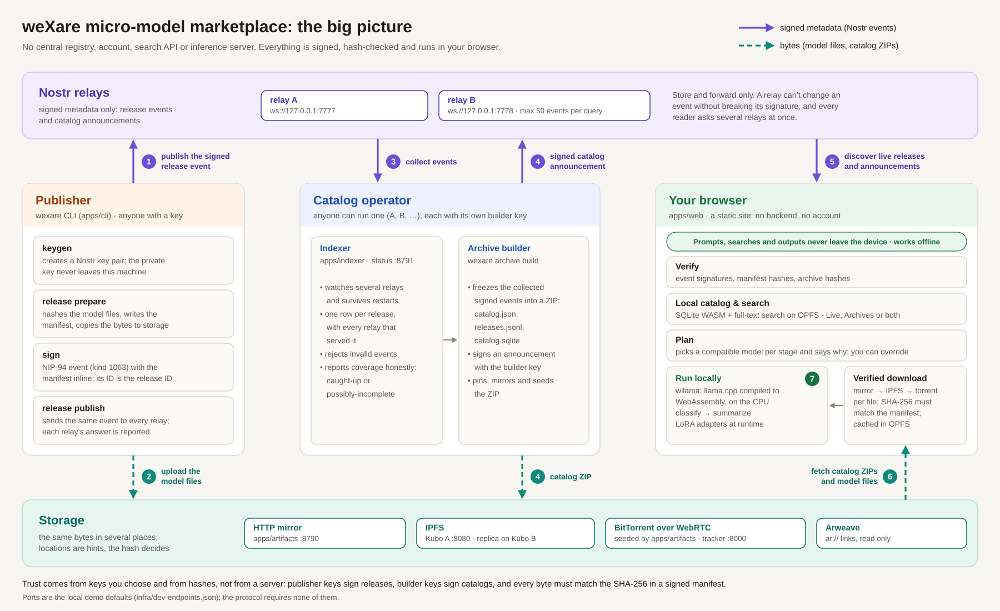

# weXare micro-model marketplace: proof of concept

Small AI models published as signed Nostr releases, stored on IPFS, torrents and HTTP mirrors,
collected by independent indexers into signed catalog snapshots, then searched, verified and run
entirely inside the browser.

- **Publish.** A CLI writes a manifest for real model files, signs a NIP-94 release event, and publishes it to two relays. Each relay's acknowledgment is reported separately.
- **Collect.** A restartable indexer watches several relays and deduplicates. It never claims coverage it did not get.
- **Archive.** A builder freezes the collected signed events into a ZIP, signs an announcement, and distributes it over IPFS, an HTTP mirror and a WebRTC-capable torrent.
- **Discover.** The browser app reads relays directly (Live), imports archives (Archives), or both (Combined), into SQLite WASM + FTS5 on OPFS. Searches stay on the device.
- **Run.** The browser downloads model files with source fallback, verifies every byte against the signed manifest, and runs GGUF models locally with wllama. It composes classification → summarization, and can apply a LoRA adapter at runtime.
- **Route.** In the simple app, a System 1 router works out every task a request asks for, and sends each step to a model on the device. The router is [Laya](https://github.com/wexare-ai/browser-laya), itself a signed catalog release. If the person adds their own API key, steps no local model can do go to an online model.

There is no central registry, account or search API, and no remote inference unless a person turns on
online help with their own key. See [docs/protocol.md](docs/protocol.md)
for the data contract, [docs/acceptance.md](docs/acceptance.md) for what has been verified, and how, and
[docs/deployment.md](docs/deployment.md) to put modelXare online with your own domains.



## Prerequisites

- Node.js 22.12 or later, below 23 (`.nvmrc` pins 22.22.2), and pnpm 11 (`corepack enable`). With
  nvm, run `nvm install && nvm use` in the repository. Newer Node versions print an "Unsupported
  engine" warning and are untested.
- Docker with Compose v2, for the two strfry relays, two Kubo nodes and the tracker. It must be
  running before `pnpm infra:up`.
  - macOS: Docker Desktop, OrbStack or Colima. The pinned images support Apple Silicon.
  - Ubuntu: `sudo apt-get install -y docker.io docker-compose-v2 && sudo usermod -aG docker $USER`.
    The infra script falls back to `sg docker` until you log in again.
- About 10 GB of free disk. The pinned model fixtures total 1.87 GB, including the 904 MB router,
  and they are copied into IPFS, the mirror and the browser.
- Network access the first time, to download the pinned fixtures from Hugging Face. No accounts are needed.
- Chrome or Chromium for the app; other browsers are untested. `pnpm --filter @wexare/tests exec playwright install chromium` provides one for tests.

## Quick start

```sh
pnpm install
pnpm infra:up          # relays A/B, Kubo A/B, tracker (docker compose; data volumes persist)
pnpm demo:prepare      # keys, fixture download + verification, releases, IPFS pins, torrents, synthetic catalog
pnpm dev               # web app :5173, simple app :5174, indexer (operator A) :8791, artifacts mirror/seeder :8790
pnpm demo:publish      # in another terminal: publish to both relays, per-relay outcomes
pnpm catalog:build     # freeze operator A's indexer into a signed, seeded snapshot
```

Open <http://localhost:5173>. Releases appear under **Discover → Live**. To import the snapshot, go to
**Sources & diagnostics** and paste the announcement JSON that `catalog:build` printed (saved under
`.data/operators/a/archives/`), or look it up by event ID. To run the classification → summarization
workflow, use **Playground**. [docs/demo-script.md](docs/demo-script.md) walks through the full
demonstration, including relay failure, offline reload and a second operator.

For people without a technical background, open <http://localhost:5174> instead. That app
(`apps/simple`), shown as **modelXare by weXare** in the weXare brand, lists models by what they
do (Summarize, Sort, Write). Opening a model gives you a text box and one button. The first
press downloads and checks the model, then it runs on the device. It uses the same engine as the
PoC but hides keys, hashes, relays and storage. It is a separate site, so it keeps its own
downloads. Its **What do you need?** box sends a request through the System 1 router; see
[Routing with System 1](#routing-with-system-1). **Xare your model**, next to the catalog, shows
how to publish a model of your own, with a starter file to fill in. Its first step is a visual guide
to training one: spec, data, LoRA/QLoRA training, eval, fuse, GGUF export, quantization, a tokenizer
check and a browser test, with common tools for each stage.

Models download when they are first needed, without a question. They stay saved until a new model
needs room, and then the ones used longest ago are removed first. They download again if needed
later. Room is made in two ways:

- **Before a download**, so that saved models stay within the space for models (4 GB by default,
  changeable in **Settings**) and within the space the browser says the site has left.
- **When the browser refuses the bytes anyway.** Some browsers, and private windows, misreport their
  space, so a download is always tried. If the browser runs out of space partway, the app takes how
  much it stored before refusing as the real room, removes models used longest ago to match, and
  retries once. Only then does it report that there isn't enough space, saying how much the browser
  really allowed.

The files of the model about to run, and the router's files during a request, are never removed.
Nothing is removed while another tab holds storage. The rule is `planEviction` in `@wexare/storage`.

The first `demo:prepare` downloads 1.87 GB and signs 10,000 synthetic records, which takes a few minutes.
Later runs reuse everything: unchanged manifests keep their signed events.

`pnpm dev` does not start the docker services. If the indexer logs `connection failed (is the relay
running? pnpm infra:up)`, start Docker, then run `pnpm infra:up`. It is safe to repeat, and it
prints a ✓ for each service once it answers. Relay and IPFS data live in docker volumes, so events
you published earlier are still there after a restart.

## Routing with System 1

The simple app opens with one box: **What do you need?** A request such as "Categorize and summarize
this message: …" is handled like this:

1. The instruction is the part before a colon near the start ("Categorize and summarize this
   message"), or a first sentence that is a question with more text after it. It is split where it
   says "and", "then" or "also", or lists tasks with commas: "Categorize" and "summarize this
   message".
2. The router reads each part on its own and picks what it asks for: sort, summarize, write, reply,
   translate or answer. It returns probabilities rather than text, and a part it is at least 50 %
   sure of becomes a step. Only the instruction is read, so a message that mentions other tasks
   ("Can you translate the notice?") doesn't add them.
3. A request without an instruction, or with no clear part, is read whole. If no task reaches 50 %,
   the person picks from the likeliest three. At most three steps run, the first ones asked for.
4. All planned steps show at once, then run in the order asked. A step goes to a model on the
   device when one can do it in the message's language, preferring a model already downloaded,
   including one an earlier step just fetched. Local models get the message without the
   instruction. Online help gets the whole request, which may name a language, and is used only for
   steps no local model can do, and only when the person has turned it on. Otherwise the step is
   reported as unavailable, in plain words.
5. **How this was decided** lists each part of the instruction, what the router took it for, and
   how sure it was.

The router is a catalog release like any model: `fixtures/releases/laya-router.json` publishes the
ONNX export of Laya (`wexare/laya-onnx`, pinned revision) with `runtime.family: "laya"` and the
`intent-routing` capability. Its four files (weights, tokenizer, tokenizer config, calibration) are
downloaded the first time a request needs them, verified, and checked again before loading, like
every model file. Clients
that don't bundle `@wexare/laya-web`, such as the PoC app, list it as unsupported.

**Online help** (Settings) takes any OpenAI-compatible service: OpenRouter, OpenAI, or a custom
address. The API key is kept in this browser's local storage only and sent only to that service.
The app says on screen when online help is on, and each answer shows which model produced it and
where.

## Commands

| Command | What it does |
| --- | --- |
| `pnpm install` | Install the pinned workspace dependencies |
| `pnpm infra:up` / `pnpm infra:down` | Start, or stop, the docker services. `down` keeps volumes. |
| `pnpm demo:prepare` | Generate demo keys, fetch and verify fixtures, and populate the mirror, IPFS (with replicas on Kubo B) and torrents |
| `pnpm dev` | Web app, simple app, indexer and artifacts mirror/seeder, with live logs |
| `pnpm demo:publish` | Publish every fixture release (and the negative fixture) to both relays |
| `pnpm catalog:build` | Build, sign, publish and seed a snapshot from operator A's indexer database |
| `pnpm test` | Fast unit tests: protocol, catalog and golden queries, storage, runtime, orchestrator, collector |
| `pnpm test:e2e` | Browser and service acceptance tests against the real services (see below) |
| `pnpm test:models` | Opt-in real-model browser tests. They download about 0.9 GB into the browser. |
| `pnpm build` | Static web builds (`apps/web/dist`, `apps/simple/dist`) and bundled operator programs (`apps/*/dist`) |
| `pnpm demo:reset --force` | Delete the demo data under `.data/`. `--volumes` also deletes relay and IPFS data, and `--downloads` the fixture models. Without `--force` it only lists what it would delete. |
| `pnpm cli <args>` | The publisher/builder CLI (`wexare --help`) |

### Tests

- `pnpm test` needs nothing running.
- `pnpm test:e2e` and `pnpm test:models` need `pnpm infra:up` and `pnpm demo:prepare`. Playwright
  starts the artifacts server (reusing one on :8790) and a production build served by `vite preview`
  on :4173, with the service worker. Tests start their own indexers on :8793 to :8795, with data under
  `.data/e2e/<run>/`. Evidence is written as JSON to `tests/results/`. The e2e run stops and restarts the
  relay containers for A16, and publishes labeled synthetic records to both relays for A17.
- `pnpm vitest run --project integration` runs the Node-side checks against the same services. The
  mirror and torrent checks also need the artifacts server on :8790, which `pnpm dev` starts.
  `WEXARE_TEST_ARWEAVE=1` adds the public Arweave gateway test, which needs internet access.
- `WEXARE_TEST_LAYA=1` turns on the checks that load the real router:
  `tests/integration/router-laya.test.ts` (routing decisions, Node) and `tests/models/router.spec.ts`
  (the Ask box end to end). They need about 4 to 5 GB of free memory, so they are off by default.

## Repository layout

| Path | Contents |
| --- | --- |
| `packages/protocol` | Schemas, canonical JSON, event and manifest verification, tag rules, operation contracts, test vectors |
| `packages/catalog` | Shared SQLite schema, FTS5 queries, source membership, archive build/read, operator state |
| `packages/storage` | Source resolution, verified downloads (Node and browser), IPFS client, mirror layout, torrents |
| `packages/runtime` | Capability detection, wllama runtime wrapper (including the LoRA adapter path), GGUF header reader |
| `packages/orchestrator` | Release selection, two-stage workflow planning and execution, LoRA dependency resolution |
| `packages/router` | System 1 routing: intents, the step-by-step loop, local-first routes, online help, router release selection |
| `apps/cli` | `wexare`: keys, `release prepare/publish`, `archive build/verify/publish`, `demo …` |
| `apps/indexer` | Persistent multi-relay collector with a read-only status endpoint |
| `apps/artifacts` | Static HTTP mirror (range, CORS, immutable caching) and WebRTC torrent seeder |
| `apps/web` | The browser app: Discover, Model library, Playground, Sources & diagnostics |
| `apps/simple` | The plain-language app: find a model by task and use it, built on the `apps/web` engine |
| `infra/` | Docker Compose for strfry ×2, Kubo ×2 and the WebSocket tracker, with images pinned by digest |
| `fixtures/` | Pinned upstream model fixtures, release definitions, sample messages, the Arweave fixture |
| `tests/` | Playwright acceptance (`e2e/`, `models/`), integration tests, the runtime compatibility spike |
| `docs/` | Protocol, demo script, acceptance checklist, runtime compatibility report |

## Running components separately

Every component reads its endpoints from flags. The defaults are in `infra/dev-endpoints.json`, and
none of them is required by the protocol.

- **Web app only:** run `pnpm --filter @wexare/web build` and serve `apps/web/dist` from any static host
  that sends `Cross-Origin-Opener-Policy: same-origin` and `Cross-Origin-Embedder-Policy:
  require-corp`; those headers enable multithreaded inference. Relays, gateways, trackers and
  trusted catalog builders are configured in **Sources & diagnostics** and can be exported or imported
  as public JSON.
- **Simple app only:** run `pnpm --filter @wexare/simple build` and serve `apps/simple/dist` with the
  same two headers. Its addresses are built in. With no `WEXARE_*` variables, it uses the local
  services in `infra/dev-endpoints.json` and shows every validly signed release. A deployment sets its
  own addresses in environment variables (`infra/deploy/app.env.example`) and shows only the
  publishers approved in `infra/publishers.json`; the build stops if a setting is wrong.
- **Publisher CLI only:** `pnpm cli keygen --out my.key.json`, then `pnpm cli release prepare --definition
  def.json --key my.key.json --out out/ --ipfs-api http://… --mirror-url https://…`, then
  `pnpm cli release publish --event out/event.json --relay wss://…`.
- **Indexer only:** `node apps/indexer/dist/main.js run --data /srv/wexare/op --name my-operator
  --relay wss://… --port 8791`.
- **Archive build only:** `pnpm cli archive build --indexer-db /srv/wexare/op/indexer.sqlite --builder-key
  builder.key.json --relay wss://… --out archives/`, then optionally `pnpm cli archive publish --zip …`.
  `--events <file>` builds from preserved signed event files, with no indexer.
- **Mirror and seeder only:** `node apps/artifacts/dist/main.js --roots-dir /srv/wexare/artifacts --port
  8790` (add `--no-seed` for HTTP only).

## Ports (local demo)

| Service | Port |
| --- | --- |
| Relay A (strfry, limit 500) / relay B (strfry, limit 50) | 7777 / 7778 |
| Kubo A API / gateway | 5001 / 8080 |
| Kubo B API / gateway | 5002 / 8081 |
| WebSocket tracker | 8000 |
| Artifacts mirror + seeder | 8790 |
| Indexer operator A / B (status only) | 8791 / 8792 |
| Web app (dev / preview) | 5173 / 4173 |
| Simple app (dev / preview) | 5174 / 4174 |

## Data and keys

All runtime state is under `.data/`, which is ignored by git. That covers keys (mode 0600), fixture
models, published releases, artifact roots, indexer databases, archives and synthetic data. Model
binaries, private keys, archives and databases never belong in the repository. The demo keys are
disposable. Private keys stay in the CLI and never reach the browser.

## Known limitations

- Only one tab at a time uses the local catalog, because the OPFS SQLite VFS holds exclusive
  handles. Opening the app in a new tab moves the catalog there, and the previous tab offers **Use
  here**. If storage still can't be opened, the app says why, falls back to an in-memory catalog, and
  offers **Reset local data**.
- The indexer resumes from a `created_at` cursor. A running indexer receives every new event, but if
  an event signed long before it is published arrives while the indexer is stopped, only a rescan
  collects it: `curl -X POST http://127.0.0.1:8791/rescan`.
- Peers-first torrent transfer needs a seeder that has finished hashing. The HTTP web-seed fallback,
  4 s by default and configurable, keeps imports usable meanwhile.
- Runtime LoRA execution relies on a wllama 3.8.1 internal. Any other version shows "Adapter execution
  unavailable in this runtime"; see [docs/runtime-compatibility.md](docs/runtime-compatibility.md).
- Gateway availability, storage retention and browser P2P connectivity are separate concerns. A pinned
  CID or a seeded torrent says nothing about whether a particular gateway or peer is reachable.
- The router (Laya fp16) is English only. Loading it takes about 3 GB of memory on top of the page.
  On this project's 8 GB build VM, it could not be loaded safely, so routing decisions with the real
  router have not been run yet. Run the `WEXARE_TEST_LAYA=1` checks on a larger machine.
- The simple app's offline cache includes the router's 28 MB WebAssembly runtime, even if routing is
  never used.
- P1 items that are not implemented: Arweave uploads (only `ar://` resolution is implemented),
  incremental or sharded catalogs, and browser publishing with a Nostr signer.

## License

Apache-2.0. Model fixtures keep their upstream licenses; see `fixtures/models.json`.
